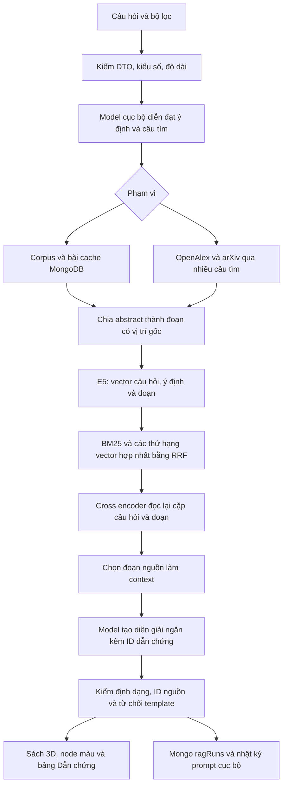

# Kiến trúc tìm ngữ nghĩa và RAG cục bộ

Mốc chức năng 0.7, ngày 04/11/2026. Mã ứng dụng, công cụ và kiểm thử viết JS/TS. Frontend React/Vite, backend Next.js, MongoDB cục bộ. Không tự train model; dùng ba model pretrained chạy bằng Transformers.js 4.3.2 đã có trong dự án.

## Mục tiêu và luồng

Người dùng có thể mô tả nhu cầu nghiên cứu bằng câu tự nhiên thay vì phải biết đúng tên bài hoặc thuật ngữ tiếng Anh. Hệ thống trả bài gợi ý, đoạn nguồn và diễn giải có trích dẫn để đối chiếu. RAG không tự bảo đảm truy xuất đủ tài liệu hoặc trả lời chính xác.

Câu ngắn dưới 5 từ được xem như tìm tên/thuật ngữ: vẫn tìm đoạn và có reranker khi truy vấn tiếng Anh, nhưng bỏ lượt LLM diễn đạt/sinh trả lời để giảm thời gian. Câu từ 5 từ trở lên chạy bước lập kế hoạch và sinh diễn giải. Đây là quy tắc kích hoạt prototype, không phải mô hình nhận biết ý định đã được huấn luyện riêng.

## Các thành phần

| Thành phần | Trách nhiệm |
|---|---|
| packages/core/src/rag.ts | Schema, chunk theo offset, BM25/RRF, evidence, kiểm citation, báo cáo fallback |
| apps/api/lib/rag/prompts.ts | Prompt phiên bản research-v2, parser/validator cho plan và diễn giải |
| search.ts | Orchestrator có dependency injection, không hardcode chủ đề VRAM |
| generation.ts và generation-worker.mjs | Hàng đợi model sinh văn bản, timeout, giải phóng khi nhàn |
| generation-runtime.mjs | Verify SHA256, chạy Qwen3 hoàn toàn local |
| rerank-runtime.mjs | Verify SHA256, model đánh giá cặp English query–passage |
| repository.ts / service.ts | Mongo cache corpus/vector, ragRuns và cache kết quả |
| audit.ts | Nhật ký prompt runtime, lưu tối đa 50 lượt stage |
| route.ts v3 | HTTP contract, body limit và giới hạn tải |
| ResearchPanel.tsx | Ý định đã diễn đạt, câu tìm, diễn giải, đoạn nguồn, link và giới hạn |

Query planner sử dụng model chung và một ví dụ định dạng về ảnh y tế; không có bảng quy tắc trả kết quả theo từ VRAM hoặc các tên paper được gán tay. Câu tìm được làm sạch, bỏ trùng, giới hạn số lượng và gửi tới host provider cố định; model không được tự chọn URL để backend truy cập.

## Model và dữ liệu

| Vai trò | Model | Revision | Dung lượng local |
|---|---|---|---|
| Embedding đa ngôn ngữ | Xenova/multilingual-e5-small Q8 | 761b726dd34fb83930e26aab4e9ac3899aa1fa78 | Khoảng129.1MiB |
| Lập kế hoạch và diễn giải | onnx-community/Qwen3-0.6B-ONNX Q4 | 58ca03a5e7b354b480b1a82b34bde8dc7b854cc0 | Khoảng885.2MiB |
| Rerank tiếng Anh | Xenova/ms-marco-MiniLM-L-6-v2 Q8 | a09144355adeed5f58c8ed011d209bf8ee5a1fec | Khoảng22.8MiB |

Manifest ở data/*model-manifest.json ghi revision, bytes và SHA256 từng file. Script setup tải theo commit cố định; runtime chỉ đọc file local và kiểm hash, không tự tải model. Qwen2.5-0.5B từng được thử nhưng bỏ sót thuật ngữ và sai định dạng; không dùng làm model bản cuối. File thử nghiệm có thể còn trong .local/models, không được frontend tải.

Giới hạn hiện tại: đọc tối đa60 bài cache Mongo cùng corpus gốc; tối đa2 câu tìm,8 ứng viên/nguồn/câu,24 bài mới sau gom trùng/lọc. Chunk100 từ, chồng20 từ, tối đa4 đoạn/abstract. Lấy tối đa40 đoạn theo hybrid, đọc lại tối đa20 bằng reranker, hiển thị tối đa6 đoạn bằng chứng. Chưa tải toàn văn PDF, chưa đánh giá trên5.000–20.000 bài.

E5 tạo vector384D cho câu gốc và ý định đã diễn đạt. BM25 là điểm khớp thuật ngữ; RRF cộng nghịch đảo thứ hạng để kết hợp các danh sách. Cross encoder đọc cặp query–passage thay vì so hai vector độc lập; kết hợp thứ hạng của nó với thứ hạng hybrid. Reranker tiếng Anh chỉ chạy khi có ý định tiếng Anh từ planner hoặc truy vấn ASCII. Nếu không chạy được thì cảnh báo và giữ hybrid.

Màu node vẫn là các dải **cosine384D của câu gốc và đoạn được chọn**, không phải điểm fusion, điểm reranker hoặc xác suất đúng. Thứ tự kết quả có thể khác thứ tự cosine vì đã kết hợp các tín hiệu. Vị trí node dùng vector toàn bài và phép chiếu PCA cũ; các đường liên kết giữa bài vẫn dùng cosine của vector toàn bài. Điểm reranker là raw logit riêng, chưa hiệu chuẩn thành phần trăm hay dải màu.

## API

`POST /api/v3/research`, Content-Type application/json. Input: query2..300 ký tự, scope library|online|combined, topK1..20 mặc định12, group/year tùy chọn. Chặn field lạ, năm đảo, số không hợp lệ, body>8192byte. Giới hạn2 lượt đang chạy và20lượt/phút/tiến trình; chưa phải rate limit phân tán theo tài khoản.

Output giữ dataset/corpus/vector/PCA cho scene, result có các paper và cosine, providers/warnings/storage, cộng research:

Trường ranking của v3 là hybrid-e5-bm25-rrf hoặc hybrid-e5-bm25-rrf-rerank, tùy model đọc lại có chạy được không. V2 vẫn giữ e5-cosine-384d. Không dùng nhãn cosine-only để mô tả thứ tự hybrid.

- plan: câu gốc, ý định, các câu tìm và method local-llm|original.
- evidence: ID, paperId, title, URL HTTPS, quote nguyên văn, start/end, coverage abstract|title, cosine/fusionScore, rerankScore nếu chạy được.
- claims: diễn giải của model và danh sách evidenceIds.
- mode: grounded-generation khi có diễn giải hợp định dạng/citation; extractive nếu chỉ có trích đoạn; insufficient nếu không có tài liệu truy xuất.
- retrieval: hybrid-passages hoặc document-fallback; gaps, traceId, model và số bài/đoạn/thời gian.

`grounded-generation` chỉ xác nhận đã cấp context và kiểm định dạng/ID, **không xác nhận mọi câu đã được kiểm chứng entailment**. Model nhỏ có thể suy luận sai hoặc trả tiếng Anh; người đọc cần đối chiếu quote. Không có nguồn thì không gọi synthesis. Output sao chép template, thiếu citation hoặc ID ngoài evidence bị loại và giữ bản trích đoạn, không báo AI trả lời thành công.

Các APIv1/v2 vẫn giữ để tương thích; frontend dùngv3 cho câu tìm đủ2 ký tự. Truy vấn rỗng vẫn dùng list/search cũ. Mất backend thì browser dùng E5 và vector tài liệu đã cache, trích phần đầu abstract và ghi rõ chưa chạy RAG/cross encoder ở trình duyệt.

## CSDL, biến và tài nguyên

Mongo tiếp tục dùng onlinePapers và onlineEmbeddings. Khi đọc cache, validate schema và model revision, chỉ ghép paper với vector của đúng ID. Bộ PCA phải giữ nguyên. ragRuns lưu traceId, câu hỏi, plan, claims/evidence và expiresAt; TTL7ngày. Nhật ký prompt runtime `.local/rag-prompts.json` giữ tối đa50 stage plan/synthesis, input/output thật, hash input, phiên bản prompt và accepted. accepted chỉ là qua validator; không phải đánh giá ngữ nghĩa độc lập. Nhật ký này là dữ liệu cục bộ, không có endpoint public để đọc.

Cache response tối đa20 key, TTL5phút. Embedding cache600 vector để tránh tính lại tất cả chunk sau mỗi query. Worker sinh văn bản chỉ một lượt đang chạy; timeout45s/lượt, tự giải phóng sau90s nhàn. Nếu bận/timeout thì fallback có thông báo. Không train trong request HTTP.

null dùng khi xác định chưa có model sinh diễn giải/trace ở báo cáo fallback. undefined dùng cho adapter rerank không truyền hoặc rerankScore chưa chạy; bỏ trường đó khi serialize JSON. Danh sách rỗng dùng[]; lỗi model embedding trả503, không gọi lexical thuần là semantic. Các giá trị gán và hàm thực tế được sinh lại trong code-catalog.json/function-catalog.md.

## Offline, bảo mật và kiểm chứng

Sau khi setup model, corpus, Mongo và tài nguyên frontend, scope library không gọi provider Internet. Model và dữ liệu local vẫn hoạt động. Scope online cần Internet để lấy tài liệu mới; combined dùng bài có sẵn và báo nguồn lỗi nếu mất mạng. Browser offline hoàn toàn có khả năng tìm vector dự phòng; chưa chạy Qwen/cross encoder trong browser. Chưa tự train model, chưa coi RAG là training.

Prompt tách system instructions và user/document payload; tài liệu được đánh dấu untrusted, citation phải tham chiếu evidence thật, React render text để không thực thi HTML do model sinh. Đây chưa phải bảo đảm chống mọi prompt injection hoặc chứng minh câu trả lời đúng. Provider có host cố định, timeout/body limit, DOI/URL được validate. Đã sửa proxy để request bị hủy không khiến pipeline trên response đã đóng làm web server dừng.

Các lệnh: `pnpm ai:rag:setup`, `pnpm test`, `pnpm typecheck`, `pnpm build`, `pnpm test:e2e`, `pnpm test:research`. Script check-offline-ai.mjs chặn fetch để kiểm3 runtime local; check-proxy-cancellation.mjs dùng upstream chậm/12request bị hủy và kiểm server còn sống. QA tách unit/fixtureE2E với nguồn và model thật. Kết quả cuối xem verification.md; không coi kiểm format/citation là benchmark chất lượng ngữ nghĩa. Chưa nghiệm thu public HTTPS443/auth/RBAC hoặc bộ dữ liệu20k.

Frontend kiểm đủ tài nguyên trong cache bằng MessageChannel trước khi báo sẵn sàng offline. Nếu thiếu asset, service worker thử tải lại khi còn mạng rồi trả trạng thái; có controller chưa có nghĩa đã đủ cache. E2E có tình huống chủ động xóa index.html, xác nhận phục hồi rồi tắt mạng và reload. Model Qwen và reranker không nằm trong cache browser.

Kết quả chốt: 116 unit / 9 file và 21 E2E đạt; catalog AST có 195 hàm có tên, 964 giá trị gán ngắn. Đây là tổng theo quy tắc catalog, không phải số mọi biến/callback trong mã. Phiên bản 0.7.0 là minor vì thêm chức năng/endpoint, giữ API v1/v2. Model có revision riêng, không gọi việc đổi weights là patch thư viện hoặc tự training.

Nguồn kỹ thuật: https://huggingface.co/onnx-community/Qwen3-0.6B-ONNX ; https://huggingface.co/Xenova/ms-marco-MiniLM-L-6-v2 ; https://huggingface.co/docs/transformers.js/ .
