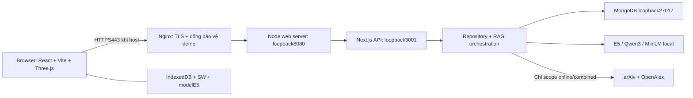
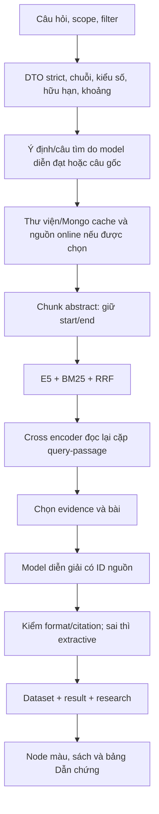

# Kiến trúc, API và cơ sở dữ liệu

## Lựa chọn kiến trúc

Kiến trúc là modular monolith: một backend Next.js được chia theo trách nhiệm, có core dùng chung với frontend. Cách này giữ chung TypeScript/schema, dễ chạy cục bộ, giảm số dịch vụ cần duy trì và phù hợp giai đoạn cơ bản. Worker thread tách model sinh văn bản và embedding khỏi vòng xử lý request chính. Chưa cần microservice hoặc dịch vụ AI trực tuyến để vận hành thư viện.

Frontend React/Vite cung cấp UI; Three.js kết xuất geometry và textureCanvas do code tạo. Backend Next Route Handlers xác thực dữ liệu/điều phối; repository đọc Mongo; core xử lý contract/vector/chunk/math. IndexedDB là dữ liệu phía trình duyệt, không thay Mongo cho toàn hệ thống.



Nginx là cấu hình hosting được đề xuất; hiện local vẫn có HTTP5173/8080 để phát triển và kiểm thử. Chứng chỉ public, Basic Auth tại proxy và MongoTLS là bước cấu hình host riêng; không tự coi code mẫu là đã triển khai.

## Flow tìm và đọc



Màu là cosine câu gốc–đoạn được chọn. Thứ tự hybrid có thể khác thứ tự cosine. PCA là vị trí hiển thị từ vector toàn bài; không dùng khoảng cách3D làm bằng chứng rằng hai bài giống nhau tuyệt đối.

## Hợp đồng API đang có

| Method | Route | Trách nhiệm |
|---|---|---|
| GET | /api/v1/health | Trạng thái storage/model và số bài corpus gốc |
| GET | /api/v1/papers | Corpus gốc để khởi tạo UI |
| GET | /api/v1/graph | Snapshot điểm3D |
| GET | /api/v1/papers/{paperId} | Hồ sơ một bài |
| GET | /api/v1/papers/{paperId}/neighbors | Các bài lân cận theo vector |
| POST | /api/v1/search | Search E5 trên corpus gốc, query rỗng để duyệt |
| POST | /api/v2/search | Tìm online/combined qua2nguồn, giữ tương thích |
| POST | /api/v3/research | Luồng RAG mới, frontend đang dùng khi có câu tìm |

### POST /api/v3/research

```json
{"query":"Tìm phương pháp phân đoạn ảnh y sinh","scope":"library","topK":6,"yearFrom":2020}
```

query2..300ký tự; scope library|online|combined; topK nguyên1..20 mặc định12. group ai|biology|medicine|physics tùy chọn. yearFrom/yearTo nguyên1900..2100, không đảo thứ tự. Field lạ bị từ chối. Không nhận URL tùy ý hoặc provider credential từ client.

Response gồm dataset(corpus+snapshot), result(items,total,durationMs,method,datasetVersion,queryPoint), providers, scope, ranking, storage, warnings và research. ranking v3 là hybrid-e5-bm25-rrf hoặc hybrid-e5-bm25-rrf-rerank. Trường score trong mỗi hit vẫn là cosine, không phải rawlogit hoặc phần trăm đúng.

research có plan, retrieval, mode, claims, evidence, gaps, traceId, model và metrics. Evidence chứa paperId, title, URL HTTPS, quote, start/end, coverage, cosine, fusionScore và rerankScore tùy chọn. Claims chỉ tham chiếu ID thuộc context. Mode grounded-generation chỉ xác nhận model có context và qua validator, chưa chứng minh entailment; extractive giữ trích đoạn; insufficient không có evidence.

### Lỗi

| HTTP | Ý nghĩa |
|---|---|
| 400 | JSON hỏng |
| 404 | Bài/tài nguyên không tồn tại |
| 413 | Body vượt8192byte |
| 415 | Content-Type không đúngJSON |
| 422 | Schema/kiểu/phạm vi sai |
| 429 | Quá số request/lượt cho phép |
| 503 | Model embedding/dataset không hoạt động |

Lỗi có error.code, error.message và requestId; không trả stack hay secret. JSON HTTP không thể biểu diễn NaN/Infinity hợp lệ; validator vẫn kiểm hữu hạn ở các hàm toán và dữ liệu không đi qua JSON. Model sinh/planner/reranker lỗi có thể trả fallback200 kèm cảnh báo; không có nghĩa đã sinh câu trả lời thành công.

## FR15 / FR16 writable APIs

`/api/v1/collections` provides collection CRUD, membership routes, and the reverse Paper lookup. `/api/v1/notes` provides note CRUD and revision-conflict responses. MongoDB stores `collections` (case-insensitive unique `name`), `collectionPapers` (unique `collectionId,paperId`) and `notes` (indexed by `paperId,createdAt`). These are the first write APIs and must be placed behind the documented Nginx/Basic Auth protection because application authentication is not yet available.

## MongoDB

| Collection | Dữ liệu | Khóa/index và ghi chú |
|---|---|---|
| papers | Corpus gốc | id unique; seed hiện30bài |
| embeddings | Vector gốc và point3D | paperId unique; vector Float32 binary384×4byte |
| datasets | Corpus version + model/PCA metadata | Bản active; repository kiểm version/hash |
| onlinePapers | Bài từ các nguồn ngoài | _id là paperId đã chuẩn hóa |
| onlineEmbeddings | Vector/point/textHash/modelRevision | _id là paperId; chỉ ghép đúng model |
| ragRuns | Query, plan, claims/evidence, traceId | expiresAt TTL7ngày; chưa có tài khoản |

ID bài arXiv hoặc oa:W…; DOI giúp gom trùng, không gom chỉ vì giống tiêu đề. Provenance giữ provider, thời điểm lấy, DOI/PDF nullable và cờ abstractAvailable. Nhãn lĩnh vực của bài online có thể là heuristic, không xem như phân loại chuyên gia.

Các documentMongo không được trả nguyên _id nội bộ trong DTO bài. Dữ liệu ngoài qua Zod. Khi MONGODB_URI đã cấu hình mà corpusMongo lỗi, backend không giả báo JSON/Mongo thành công. Đọc cache online lỗi có thể giữ corpus gốc và phát cảnh báo theo thiết kế.

## Dữ liệu trong web

IndexedDB paper-magic-v1 phiên bản2 có stores library, bookmarks, online. Corpus/vector cache dùng cho tìm lại và vẽ; bookmark thuộc trình duyệt. Service worker cache shell/assets/modelE5, không cache API lỗi. Handshake kiểm đủ asset trước khi UI báo sẵn sàng offline; có thể sửa asset thiếu khi còn mạng.

Mongo online cache và IndexedDB không phải cơ chế đồng bộ tài khoản. Máy/trình duyệt mới không tự có toàn bộ bookmark hoặc cache cũ. Không lưu modelQwen/reranker vào service worker.

## Các giới hạn vận hành

v3 giới hạn2request đang chạy,20lượt/phút/tiến trình. Generator một lượt/45s, idle90s giải phóng. Embedding batch≤3, pending≤12; orchestrator dùngbatch2. Corpus cache online đọc≤60bài,≤24bài mới/query,≤4chunk/bài. Responsecache20key/5phút, embeddingcache600vector. Đây là giới hạn prototype, không phải SLA hoặc rate limit phân tán.
