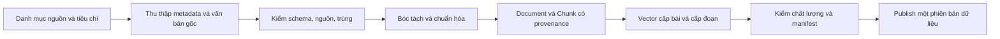
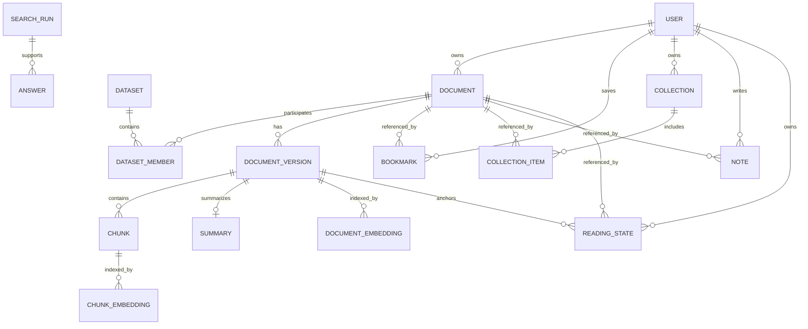

# Thiết kế dữ liệu theo nghiệp vụ

Cập nhật 14/11/2026 cho FR17, FR20 và FR24. Đọc cùng [thiết kế backend và API](27-backend-domain-baseline.md).

## 1. Dữ liệu cần phục vụ điều gì?

Paper Magic tìm tài liệu theo ý nghĩa câu hỏi, mở đúng nội dung liên quan và trình bày kết nối trong không gian 3D. Nguồn gồm bài báo nghiên cứu và tài liệu học do người dùng nhập. Khả năng trả lời phải giới hạn theo nội dung thực sự có.

| Nhiệm vụ | Dữ liệu bắt buộc |
|---|---|
| Tìm bài liên quan | Tiêu đề, abstract gốc, metadata và vector cấp bài |
| Trả lời có dẫn chứng | Văn bản nguồn, chunk, trang/mục khi có, vector đoạn |
| Hỏi sâu về thí nghiệm/phương pháp | Toàn văn có chứa thông tin đó; abstract không tự thay toàn văn |
| Vẽ bản đồ 3D | Vector cấp tài liệu, phép PCA cố định và cạnh có căn cứ |
| Tìm trong tài liệu học | Text bóc tách, người sở hữu, chunk, vector, nguồn file |
| Tìm offline | Bản dữ liệu đã chọn và model/tài nguyên tương thích trên thiết bị |

Summary tiếng Việt là phần đọc nhanh có thể được sinh từ nguồn. Nó không thay abstract/toàn văn hoặc trở thành bằng chứng gốc. Tìm kiếm ngữ nghĩa, sinh summary và train model là ba công việc khác nhau. Giai đoạn này dùng model có sẵn, chưa có yêu cầu tự train.

## 2. Tập dữ liệu nên thu thập

### Bài báo công khai

Mục tiêu cơ bản là 5.000 bài, có thể mở rộng tới 20.000 sau kiểm chứng. Bắt đầu pilot 100 bài có khoảng 25 bài mỗi lĩnh vực để kiểm quy trình. Các con số này là mục tiêu thiết kế, không phải dữ liệu đã thu thập.

| Lĩnh vực | Chủ đề lấy mẫu | Nguồn đề xuất để kiểm và thu thập |
|---|---|---|
| AI | NLP, thị giác, học máy, hệ thống AI | arXiv, OpenAlex |
| Sinh học | Protein, gene, mô hình sinh học | PubMed, nguồn bài mở được liên kết qua metadata |
| Y tế | Chẩn đoán hình ảnh, mô hình lâm sàng, phương pháp y sinh | PubMed, PMC và metadata OpenAlex |
| Vật lý | Lượng tử, quang học, mô phỏng | arXiv, OpenAlex |

Chọn nhiều năm và chủ đề nhỏ, tránh chỉ lấy trang kết quả mới nhất. Ghi truy vấn, bộ lọc, cursor, thời điểm và seed chọn mẫu. Nhãn chính dùng để phân bố dữ liệu, nhãn chủ đề bổ sung có thể nhiều giá trị. Bài AI y tế vẫn là một document, không nhân đôi để tính vào hai nhóm.

Mốc 5.000 có thể hướng tới khoảng 1.250 bài theo mỗi nhãn chính; khi một nhóm thiếu dữ liệu phải báo thiếu, không gán nhãn giả cho đủ số. Số lượng không thay việc đánh giá chất lượng.

Chỉ lấy toàn văn khi có quyền truy cập/giấy phép phù hợp. Có metadata hoặc link PDF không mặc nhiên cho phép lưu và phát lại PDF. Bản gốc, phiên bản arXiv và bản xuất bản phải giữ quan hệ nguồn thay vì xóa dấu vết khác phiên bản.

### Tài liệu học cá nhân

Nhận PDF có văn bản, TXT và Markdown do người dùng chọn. File riêng tư mặc định; không tự đưa vào thư viện công khai. PDF ảnh quét được đánh dấu cần OCR, chưa nằm trong pipeline cơ bản. Không lấy nội dung ngoài phạm vi người dùng cung cấp.

### Bộ câu hỏi đánh giá

Tạo tách biệt với kho tài liệu. Pilot đề xuất 60 câu: 40 câu theo lĩnh vực, 10 câu liên ngành và 10 câu thiếu bằng chứng hoặc không có câu trả lời. Mỗi câu có bài/đoạn liên quan do người đọc kiểm, ngôn ngữ và mức độ liên quan. Không dùng chính summary AI tự tạo làm đáp án chuẩn. Giữ một phần câu chưa dùng để điều chỉnh pipeline.

## 3. Quy trình thu thập và xử lý



1. **Thu thập:** API nguồn hoặc gói dữ liệu có nguồn rõ; JS/TS lưu raw response, download status, license, checksum và thời điểm. Fetch có timeout, retry/backoff và checkpoint để tiếp tục, không gọi lại toàn bộ khi một file lỗi.
2. **Chuẩn hóa metadata:** ID nội bộ ổn định; giữ external ID/DOI; chuẩn Unicode và khoảng trắng, tác giả/năm/URL. Không sửa ý nghĩa title hoặc abstract để làm đẹp.
3. **Loại trùng:** DOI hoặc external ID là căn cứ chính. Trùng hash nội dung có thể gom; tiêu đề gần giống chỉ là cờ cần kiểm. Phiên bản khác có thể là version cùng document, không xóa nhầm bài khác.
4. **Bóc tách:** PDF giữ text từng trang và parser revision. Không xóa công thức/bảng bừa bãi. Nếu bảng/công thức không bóc được thì ghi giới hạn; không coi text extraction là đã hiểu được mọi hình/bảng.
5. **Chia đoạn:** dự kiến 256 token/đoạn, overlap 32 token; tính token thật và dành chỗ cho prefix/title trong trần input model. Giữ section/page và offset. Bài chỉ có title ghi coverage=title, không tạo abstract giả.
6. **Tạo vector:** cấp tài liệu dùng title+abstract để tìm bài/vẽ graph; cấp đoạn dùng nội dung từng chunk để truy xuất dẫn chứng. Cùng model/pipeline ở mỗi chỉ mục; vector toàn bài không được gắn nhãn vector đoạn.
7. **Summary:** tùy chọn, giữ ngôn ngữ, phạm vi nguồn, model/prompt revision và trạng thái đã kiểm. Sửa summary không tự yêu cầu tính lại embedding title+abstract.
8. **Kiểm/publish:** chỉ công bố generation khớp nội dung và vector. Lỗi được đưa vào danh sách rejected/pending với lý do, không âm thầm bỏ rồi báo đủ.

Các giới hạn token, kích thước file và batch là cấu hình cần kiểm trên pilot, không là kết quả hiệu năng đã đạt.

## 4. Mô hình nghiệp vụ

`Document` là tài nguyên chung. Paper và Study Document là hai loại, không cần hai hệ tìm kiếm riêng.



Diagram thể hiện quan hệ nghiệp vụ, không yêu cầu join hoặc foreign key quan hệ trong Cassandra. Document công khai curated có owner=null; Study Document phải có owner. SearchRun riêng tư gắn principal/scope; quyền được kiểm lại khi tạo Answer.

| Entity | Trường cốt lõi | Quy tắc |
|---|---|---|
| Dataset | id, version, manifest, counts, status | Một bản dữ liệu có thể tái lập, không phải danh sách bài yêu thích |
| Document | id, kind, title, ownerId, visibility, subjects, activeVersionId, revision | Study riêng tư mặc định. Lưu nội bộ latestReplacementVersionId và tombstone. |
| DocumentVersion | id, documentId, source, coverage, textHash, parserRevision, activeIndexGeneration, processingStatus, jobId | Giữ văn bản theo phiên bản. Khi ready, coverage, textHash, parserRevision và activeIndexGeneration phải có giá trị. |
| Source | provider, externalIds, sourceUrl, license, fetchedAt, rawHash | Phải truy được nguồn gốc; giá trị chưa biết ghi null có ý nghĩa |
| Chunk | id, versionId, ordinal, text, page, section, start, end, textHash | Trang/mục nullable; offset theo text chuẩn hóa được định nghĩa |
| Embedding | targetId, targetKind, modelRevision, pipelineRevision, vector, generation | targetKind phân biệt document và chunk |
| Summary | versionId, text, language, sourceCoverage, generator, reviewStatus | Dữ liệu dẫn xuất, không là nguồn chân lý |
| Bookmark/Collection/Note | id, ownerId, documentId hoặc collectionId, revision | Quyền theo tài khoản, tham chiếu document còn hiệu lực |
| SearchRun | id, query, filters, permittedScope, indexRevision, expiresAt | Chứng cứ lượt tìm; khác lịch sử cá nhân lưu dài hạn |
| SearchHistory | id, ownerId, queryId, query, filters, createdAt | Một lần submit tạo một bản ghi, không ghi theo mỗi frame/debounce |
| ReadingState | id, ownerId, documentId, versionId, chunkId, page, progress, revision, updatedAt | Một bản ghi theo ownerId + documentId. Mốc trỏ vào bản đã đọc và chỉ chủ mốc được truy cập. |
| BrowserSettings | theme, fontScale, reducedMotion, sceneQuality | Một bản ghi IndexedDB theo hồ sơ trình duyệt và origin. Khách và người dùng chung hồ sơ dùng cùng thiết lập. |
| Answer | id, searchId, evidence, claims, mode, status | Chỉ dùng evidence được phép đọc, không suy diễn từ summary như nguồn gốc |

Các entity đều có ID ổn định. Mongo `_id` nội bộ không tự thành DTO công khai. `revision` là version của entity, `datasetVersion`, `modelRevision` và version API là các khái niệm khác nhau.

## 5. Ba nơi lưu và kho file

| Nơi | Dữ liệu giữ | Vai trò |
|---|---|---|
| Raw files ngoài web root | Response nguồn, PDF/TXT/MD gốc, checksum, license | Đối chiếu và tái xử lý |
| MongoDB | Dataset, Document/Version/Chunk, quyền, summary, tài khoản và dữ liệu cá nhân, job/outbox/receipt | Nội dung chuẩn và quy tắc nghiệp vụ |
| Cassandra | Vector cấp tài liệu/đoạn theo scope, generation, model/pipeline và ID tham chiếu | Chỉ mục truy xuất có thể dựng lại |
| IndexedDB | Phần được chọn lưu offline, vector/metadata, ghi chú, mốc đọc và client outbox theo tài khoản, thiết lập theo hồ sơ trình duyệt | Phục vụ thiết bị khi mất kết nối |
| Cache Storage | App shell, model/WASM đã cài, assets production | Tài nguyên ứng dụng, khác entity đồng bộ |

Lưu token hoặc mật khẩu trong IndexedDB/localStorage không thuộc thiết kế. File gốc phục vụ qua API có kiểm quyền; không public thư mục raw.

MongoDB đích cần transaction cho entity+changeLog+receipt+outbox. Cấu hình replica set là bước triển khai phải kiểm riêng. Không có transaction xuyên Mongo/Cassandra. Index generation mới chỉ publish sau khi hoàn tất; tìm kiếm luôn kiểm quyền/active version lại ở Mongo. Cassandra chưa có adapter/runtime được nghiệm thu, không chọn CQL cụ thể khi chưa kiểm query thực tế theo phiên bản.

Khi ghi mốc đọc, MongoDB kiểm owner, quyền đọc, quan hệ Document–Version–Chunk, trang nguồn và tiến độ. Unique key `ownerId + documentId` bảo vệ tạo đồng thời. Cập nhật đối chiếu revision và commit mốc, sự kiện đồng bộ và receipt cùng giao dịch. IndexedDB giữ bản nháp của tài khoản khi mất kết nối hoặc xung đột.

Khi nhận file thay thế, tăng revision của Document và ghi `latestReplacementVersionId` cùng phiên bản, job và receipt. Mỗi lượt worker chuẩn bị một generation riêng. Giao dịch kích hoạt chỉ chạy với tài liệu chưa xóa, yêu cầu thay mới nhất, lease hợp lệ và generation khớp đầu vào chỉ mục. Bản từng kích hoạt có thể đọc lại trong khi còn được lưu và có quyền. Tombstone trên tài liệu cha chặn mọi bản sau khi xóa, kể cả nội dung vẫn còn trong kho file hoặc chỉ mục.

FR24 lưu bốn giá trị thiết lập cục bộ. `theme` nhận `system/light/dark`, `fontScale` từ 0.8 đến 1.5, `reducedMotion` là boolean, `sceneQuality` nhận `low/medium/high`. Hồ sơ chưa có bản lưu dùng giá trị mặc định. Đăng nhập và đổi tài khoản giữ cấu hình của hồ sơ đó.

## 6. Hình dạng record tối thiểu

```json
{
  "id": "document-id",
  "kind": "paper",
  "title": "Tên bài gốc",
  "ownerId": null,
  "visibility": "public",
  "subjects": ["ai", "medicine"],
  "primarySubject": "medicine",
  "activeVersionId": "version-id",
  "revision": 1
}
```

```json
{
  "id": "chunk-id",
  "versionId": "version-id",
  "ordinal": 0,
  "text": "Nội dung trích nguyên văn từ phần nguồn đã chuẩn hóa",
  "page": null,
  "section": "abstract",
  "start": 0,
  "end": 58,
  "textHash": "sha256-cua-doan-text"
}
```

Đây là ví dụ hình dạng, chưa là fixture hợp lệ có hash/offset thật. ID triển khai dùng UUID; hash đủ 64 ký tự hex. `start/end` là offset UTF-16 trong text của trang/mục đã chuẩn hóa. Khi chuẩn hóa thay đổi phải tạo version mới, không để offset trỏ nhầm. Null biểu thị không có trang cho abstract; field tùy chọn chưa gửi có thể bỏ khỏi request. Không dùng số 0 thay score chưa tính.

## 7. Kiểm dữ liệu trước khi chấp nhận

| Kiểm | Điều kiện |
|---|---|
| Cấu trúc | Field đúng schema, chuỗi không rỗng, số hữu hạn, kiểu nguyên/khoảng đúng |
| Định danh | Không ID trùng; liên kết Document–Version–Chunk–Embedding không mồ côi |
| Nội dung | Hash khớp; kiểm mẫu text/page; không cắt abstract âm thầm |
| Vector | Đúng chiều 384 khi giữ E5 hiện tại, L2, cùng model/pipeline, target đúng loại |
| PCA | Point tính lại khớp, query/node cùng projection; giải thích phương sai khác accuracy |
| Nguồn và quyền | Có provenance; kiểm chính sách file và không trộn tài liệu riêng vào dataset công khai |
| Tìm kiếm | Precision@K/Recall@K hoặc nDCG theo bộ nhãn; ghi rõ cách gán nhãn và số câu |
| RAG | Quote/page đúng, câu không có bằng chứng được báo rõ, không suy ra đủ toàn văn từ abstract |

Precision@K: tỷ lệ kết quả liên quan trong K kết quả đầu. Recall@K: tỷ lệ tài liệu liên quan đã tìm được trong tập đúng đã xác định. nDCG: đánh giá thứ tự với mức liên quan nhiều cấp. Chưa có nhãn đủ thì không công bố những chỉ số này là kết quả thực tế.

## 8. Xử lý bộ 7.500 bài đã có

Báo cáo kiểm dữ liệu trong gói gửi nhóm ngày 13/11 ghi nhận ID, schema, vector, hash và PCA đạt. Mọi bản ghi mang nhãn AI/năm 2026, với 171 input vượt 512 token. Vector là title+abstract cấp bài. [Dataset trong JSTS](../datasets/arxiv-7500/README.md) mô tả các tệp bàn giao.

Giữ nguyên raw, dùng như ứng viên của phần dữ liệu AI, kiểm nguồn/nhãn và bổ sung các ngành còn thiếu. Giữ vector cấp bài tương thích; tạo chunk vectors mới khi cần RAG. Không thay thư viện 30 bài trong runtime ở bước thiết kế này. Không đổi nhãn giả hoặc gọi summary sẵn có là dữ liệu toàn văn.

Đầu ra dataset mới gồm `documents`, `versions`, `chunks`, document/chunk embeddings, projection manifest, nguồn/giấy phép, reject report và evaluation set. Xuất theo shard/gói có checksum, không buộc một JSON khổng lồ tải vào mọi tab.
