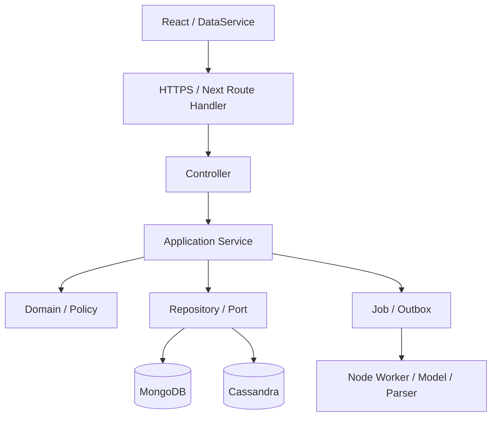

# Thiết kế backend và API theo mô hình nghiệp vụ

Cập nhật ngày 14/11/2026 cho FR17, FR20 và FR24. Các API dưới đây là hợp đồng thiết kế. [Mô hình dữ liệu](26-data-domain-baseline.md) mô tả các bất biến mà server cần thực thi.

## 1. API là hợp đồng của tài nguyên

Trong Paper Magic, tài nguyên là Document, Chunk, Search, Answer, Bookmark, Collection và Note. Endpoint phải nói rõ đang đọc/tạo/thay đổi tài nguyên nào, dữ liệu gửi/nhận, quyền, lỗi và hành vi retry.

Ví dụ: tạo collection thành công trả **201 Created**, `Location: /api/v4/collections/{id}`, body là collection vừa tạo. Nếu client timeout và gửi lại cùng idempotency key thì server trả cùng kết quả đã lưu thay vì tạo collection thứ hai.

Thiết kế theo mô hình nghiệp vụ là điểm khởi đầu của API. Việc đặt tên endpoint theo entity chưa đủ để khẳng định đã áp dụng toàn bộ Domain-Driven Design; còn phải xác định quy tắc, quyền sở hữu và ranh giới module.

HTTP/JSON phù hợp với frontend hiện tại. Không có nhu cầu gRPC trong giai đoạn này. Trình duyệt có thể dùng gRPC-Web qua giải pháp phù hợp, vì vậy không trình bày thành khẳng định tuyệt đối rằng trình duyệt không thể dùng gRPC.

## 2. Phạm vi tính năng và module

| Module | Chức năng | Dữ liệu sở hữu |
|---|---|---|
| Identity | Đăng ký/đăng nhập/đăng xuất, hồ sơ và kiểm session | User, Session, role |
| Documents | Duyệt, đọc, nhập, cập nhật, xóa tài liệu có quyền | Document, Version, Source, Chunk |
| Ingestion | Parse file, làm sạch, chunk, embedding, publish generation | Upload/job/staging, index manifest |
| Search | Tìm chung paper/study, lọc, ranking, lân cận/graph | SearchRun và DTO kết quả |
| Research | Tạo câu trả lời theo evidence, log prompt, fallback | Answer, evidence, prompt audit |
| Personal Library | Bookmark, collection, note, lịch sử và vị trí đọc | Các bản ghi riêng theo tài khoản, gồm `ReadingState` |
| Thiết lập trình duyệt | Theme, cỡ chữ, giảm chuyển động và chất lượng cảnh 3D | `BrowserSettings` trong IndexedDB theo hồ sơ trình duyệt, dùng được khi chưa đăng nhập |
| Sync | Change feed, bootstrap, phiên bản và cơ chế replay an toàn | Cursor, mutation receipt, outbox |
| Administration | Import dataset đã kiểm, xem/retry job, reindex | Import manifest và job quản trị |

Lõi đúng đề tài: Document/Chunk, ingestion, search, evidence và graph. Tài khoản và thư viện cá nhân hỗ trợ trải nghiệm và bảo vệ tài liệu học tập. Chia sẻ công khai, gửi email reset mật khẩu, OCR và những tiện ích khác trong tài liệu 20 là phần mở rộng, không tự đưa vào lõi chỉ vì đã liệt kê.

Không triển khai tất cả endpoint hoặc tất cả database cùng lúc để chứng minh đủ công nghệ. Mỗi phần phải có contract/test trước khi bật. Cassandra vẫn nằm trong thiết kế đã chọn, nhưng phải kiểm khả năng index theo scope, tài nguyên và triển khai thật.

## 3. Các lớp backend



| Lớp | Trách nhiệm |
|---|---|
| Route | Khai báo method/path/runtime và lắp controller |
| Controller | Giới hạn body, parse DTO/schema, nhận principal, gọi service, ánh xạ status/header |
| Service | Điều phối một nghiệp vụ, transaction/job, idempotency và cache theo quyền |
| Domain/Policy | Ownership, version, trạng thái, quyền tài liệu, luật ghi/xóa |
| Repository/Adapter | Đọc/ghi Mongo, tìm candidate Cassandra, blob/model qua port |
| Worker | Job nặng có lease, retry hữu hạn, kiểm generation trước publish |

Auth wrapper xác định principal; service vẫn phải kiểm quyền tài nguyên. Không query DB trong controller; không import NextRequest vào domain; không để repository tự quyết tài liệu riêng có thể public. Class hoặc factory đều dùng được, không tạo lớp/file rỗng chỉ để đủ tên pattern.

## 4. Cấu trúc dự án đích

```text
apps/web/src/
  features/                       # UI theo nghiệp vụ
  data/data-service.ts             # facade cho toàn UI
  data/local/                     # IndexedDB và migration
  data/sync/                      # clientOutbox, replay, conflict
  data/network/                   # HTTP adapter
  workers/                        # E5 và xử lý local
  scene/                          # Three.js, Canvas, toán và camera
apps/api/
  app/api/v4/.../route.ts          # Next HTTP adapters
  src/bootstrap/container.ts      # lắp dependency/pool/config
  src/shared/http/                # error, parser, guard, requestId
  src/modules/<module>/
    README.md
    ai-development-log.jsonl
    presentation/                 # controllers và presenters
    application/                  # services và command/query handlers
    domain/                       # policy/quy tắc thuần
    ports/                        # interfaces
  src/infrastructure/             # Mongo/Cassandra/blob/model adapters
  worker/                         # job process JS/TS
packages/core/                    # toán/vector/PCA/chunk dùng chung
packages/contracts/               # DTO schema đích, chưa tạo package runtime
```

Next.js vẫn là backend đã chọn, không thêm Express chỉ để có controller. Modular monolith chia rõ module nhưng cùng hệ backend, worker Node chạy riêng cho ingestion/model. Chưa cần microservices. Sách dùng Three.js để render; JS/TS, số phức, sin/cos và nội suy tính chuyển động. Cảnh chỉ nhận view model có ID/point/score/edges, không truy cập database.

## 5. Luồng đọc/tìm online và offline

1. UI gửi câu hỏi cho DataService.
2. Local engine dùng dữ liệu/model đã có, trả kết quả ban đầu. Không có tài nguyên thì báo chưa đủ local, không báo đã tìm thành công.
3. Nếu kết nối backend được, DataService gửi request cùng queryId. Tác vụ local/server có thể chạy song song, không chờ tải model local mới gọi server.
4. SearchService xác định scope được phép, tạo vector, tìm candidate, đọc lại nội dung/quyền ở Mongo, xếp hạng rồi trả DTO gọn.
5. DataService cache phần được phép và cập nhật cùng queryId, bỏ response đến muộn của lượt cũ.
6. UI dựng màu và graph đúng query/model/projection. Không trả toàn corpus/vector mỗi lần search.

Mất kết nối thì bước bổ sung server chờ, luồng UI không đổi. Một luồng điều phối không có nghĩa offline tìm được dữ liệu chưa tải hoặc có đủ Qwen như server. `navigator.onLine` chỉ là tín hiệu, request thực tế mới quyết định khả năng truy cập.

## 6. Một đường ghi theo API tài nguyên

**Thay quyết định trong 21–24:** không dùng `/sync/push` chứa lệnh nghiệp vụ tùy loại làm đường ghi chính. Mỗi nghiệp vụ có API tài nguyên; DataService dùng cùng API cho thao tác đang online và replay thao tác offline. Điều này gắn trực tiếp với bài giảng về HTTP/resource, không tạo hai controller khác nhau cho cùng luật ghi.

```text
Thao tác lưu/sửa
  -> IDB transaction: bản nháp hiển thị + clientOutbox
  -> Network adapter/replay cùng REST endpoint
  -> Controller -> Service -> Policy/CAS
  -> Mongo transaction: entity + change log + receipt (+ outbox server)
  -> response canonical -> cập nhật IDB, đánh dấu thao tác đã xác nhận
```

Outbox giữ `operationId`, tài khoản/device, resourceId, action, payload, baseRevision, dependencyIds và trạng thái. URL/method được adapter tạo từ action đã định nghĩa, không nhận URL tùy ý từ data. Mutation retry giữ cùng key/body/precondition. Auth/upload/RAG/admin là tác vụ server-only, không tự phát lại đăng nhập hoặc chia sẻ khi offline.

GET bootstrap và GET sync/changes vẫn phục vụ dữ liệu theo cursor. Chúng không thực thi thao tác ghi nghiệp vụ. Không giữ đồng thời `/sync/push` cũ và REST CRUD mới như hai luật khác nhau.

## 7. Nhóm API

Prefix thiết kế mới là `/api/v4`, giữ quyết định namespace trước để không ghi đè contract v1–v3 đang tồn tại. Số 4 không đại diện công nghệ, hybrid search hoặc số tính năng. Bản mới dùng nhất quán một họ contract; v1–v3 chỉ là tương thích trong giai đoạn chuyển đổi có kiểm soát.

Danh mục đầy đủ có method/quyền/retry/precondition/status/Location trong [resource-api.registry.json](design/resource-api.registry.json), sinh từ công cụ thiết kế. Tài liệu này chốt hành vi nghiệp vụ; OpenAPI 45 endpoint ngày 12/11 có `/sync/push` được đánh dấu bản cũ, chưa sử dụng như contract active. Request/response schema theo registry mới đã được định nghĩa trong [software-api.openapi.json](design/software-api.openapi.json). Cần kiểm thêm policy/cross-field và HTTP thực tế khi code route.

### Tài khoản

- `POST /users`: tạo tài khoản, 201 và Location tài khoản.
- `GET /users/me`, `PATCH /users/me`: hồ sơ của tài khoản hiện tại.
- `POST /sessions`, `GET /sessions/current`, `DELETE /sessions/current`: tạo/đọc/thu hồi phiên.

Không đặt JWT vào định nghĩa REST. Cơ chế phiên được chọn riêng: cookie HttpOnly/Secure/SameSite, Origin/CSRF và session hash ở backend. Nếu sau này chọn JWT thì có đánh giá vòng đời/thu hồi, không mặc định JWT tốt hơn chỉ vì có trong báo cáo.

### Tài liệu

- `GET /documents`: danh sách có quyền, lọc và cursor.
- `POST /documents`: nhập file, tạo Document 201 + Location + jobId, `processingStatus=queued`; chưa tuyên bố tìm được ngay.
- `GET /documents/{id}`: đọc `Document`, gồm `revision`, `activeVersionId` và ETag. Chủ sở hữu dùng revision cho thay file và ETag cho sửa metadata hoặc xóa.
- `PATCH /documents/{id}`: chủ sở hữu tài liệu `kind=study` sửa `title`, `subjects` hoặc `primarySubject` với `If-Match` và `Idempotency-Key`. Trả 200 và `Document` kèm ETag mới. Nhãn chính khác null phải có trong danh sách nhãn sau khi cập nhật. DTO hoặc quan hệ trường sai trả 422. Nếu tiêu đề tham gia tạo vector, ghi metadata và lập lịch cập nhật chỉ mục cùng giao dịch. Nguồn vẫn đọc được, tìm kiếm chỉ dùng generation khớp dữ liệu hiện hành.
- `DELETE /documents/{id}`: chủ sở hữu tài liệu `kind=study` gửi `If-Match` và `Idempotency-Key`, không body. Trả 204 khi tombstone đã commit. Với cả PATCH và DELETE, thiếu `If-Match` trả 428, ETag cũ trả 412. Client đọc lại `Document` và xác nhận ý định trước khi gửi key mới.
- `GET /documents/{id}/chunks`, `/source`, `/neighbors`: nội dung, file có quyền và bài gần nghĩa.
- `GET /documents/{id}/versions/{versionId}`: trả 200 với `DocumentVersion`. Chủ sở hữu thấy cả trạng thái đang xử lý hoặc thất bại. Người được phép đọc thấy các bản từng kích hoạt và còn được lưu. Trả 404 nếu sai tài liệu cha, tài liệu đã bị xóa hoặc caller không có quyền.
- `GET /documents/{id}/versions/{versionId}/chunks`: trả 200 `ChunkPage` của bản chỉ định. Dùng `fromChunkId` để mở từ đoạn đã lưu, hoặc dùng `cursor` cho trang tiếp theo. Gửi cả hai trả 400, chunk ngoài phiên bản trả 422 và cursor hết hạn trả 410. Cursor gắn với tài liệu và phiên bản.
- `GET /documents/{id}/versions/{versionId}/source`: trả 200 `application/octet-stream` nếu caller có quyền lấy nguồn của bản chỉ định. Cả hai route nội dung chỉ phục vụ bản từng kích hoạt, còn được lưu và hiện được phép đọc. Trả 404 khi không đáp ứng các điều kiện này. File được phục vụ qua API có kiểm quyền.

POST nhập file nhận metadata cố định + file multipart streaming có limit; offline giữ file local và documentId trước, online gửi cùng ID/key. Client embedding không tự trở thành server index đáng tin. File và JSON có giới hạn khác nhau.

#### FR20 Thay file và theo dõi xử lý

`POST /documents/{id}/versions` dành cho chủ sở hữu tài liệu `kind=study`. Client lấy `Document.revision` từ `GET /documents/{id}` rồi gửi `baseDocumentRevision`, `clientVersionId` và `file` trong multipart, kèm `Idempotency-Key`. Part revision có dạng chữ số thập phân nguyên dương (ví dụ `7`) và được giải mã thành số nguyên an toàn. Giới hạn là 20 MiB cho file và 21 MiB cho toàn multipart. Định dạng hỗ trợ gồm PDF có text, TXT và Markdown.

| Tình huống | Phản hồi |
|---|---|
| Thiếu part `baseDocumentRevision` | `428 BASE_DOCUMENT_REVISION_REQUIRED` |
| Part lặp, rỗng, dạng file, sai kiểu hoặc ngoài miền số nguyên dương an toàn | `422 INVALID_BASE_DOCUMENT_REVISION` |
| Revision hợp lệ nhưng đã cũ | `409 DOCUMENT_REVISION_MISMATCH`. Đọc lại Document và xác nhận ý định trước khi gửi yêu cầu mới. |
| Cùng key nhưng fingerprint khác hoặc `clientVersionId` đã được dùng cho yêu cầu khác | `409 IDEMPOTENCY_KEY_REUSED` hoặc `409 VERSION_ID_CONFLICT` |
| Multipart lỗi cú pháp, vượt giới hạn hoặc loại file không hỗ trợ | 400, 413 hoặc 415 tương ứng |
| Nhận file và tạo phiên bản | 201 + `Location: /api/v4/documents/{id}/versions/{versionId}` và `VersionCreated` |

Server kiểm quyền hiện tại, kiểm định dạng để tính fingerprint từ `baseDocumentRevision`, `clientVersionId` và SHA-256 của file, rồi tra receipt trước khi so revision hiện tại. Khi mất phản hồi, client gửi lại cùng key, revision, ID và file. Một yêu cầu mới đã được xác nhận dùng key mới và ID phiên bản mới. Ghi phiên bản, job, receipt, sự kiện đồng bộ và `latestReplacementVersionId` cùng giao dịch MongoDB. Tăng revision của Document ngay khi chấp nhận yêu cầu. `activeVersionId` vẫn trỏ tới bản đang phục vụ.

Ví dụ gửi ba part `baseDocumentRevision=7`, `clientVersionId=20000000-0000-4000-8000-000000000002` và `file=tai-lieu-moi.pdf`. Phản hồi 201 chứa `version.id` bằng ID client đã gửi, `jobId` bằng `version.jobId` và `processingStatus: "queued"`. Bản queued có thể trả null cho `coverage`, `textHash`, `parserRevision` và có `activeIndexGeneration: null`. Bản ready cần đủ bốn giá trị. OpenAPI có JSON đầy đủ cho hai trạng thái.

Chủ sở hữu poll `GET /jobs/{jobId}` với backoff. Phản hồi 200 `Job` có `resourceId=versionId`, `status`, `stage`, `attempt` và `error`. Worker retry lỗi tạm hữu hạn. Khi job kết thúc, client đọc lại Document để xác nhận bản hiện hành. Yêu cầu theo dõi job của tài liệu đã xóa trả 404.

Worker ghi nội dung và index vào generation riêng cho mỗi lượt xử lý. Trong giao dịch kích hoạt, cập nhật có điều kiện phải kiểm đồng thời tài liệu còn sống, `latestReplacementVersionId` trùng phiên bản đang xử lý, lease/lượt chạy còn hiệu lực và generation khớp nội dung cùng metadata dùng để lập chỉ mục. Công bố generation, đổi `activeVersionId`, tăng revision và xác nhận job trong giao dịch đó. Nếu A đang phục vụ và B rồi C được chấp nhận, chỉ C có quyền thay A. B chưa kích hoạt kết thúc `failed` với `VERSION_SUPERSEDED`. Nếu C thất bại, A tiếp tục phục vụ. Đánh dấu lỗi của job B chỉ tác động lên job/phiên bản B còn đang xử lý.

Xóa ghi tombstone, receipt, sự kiện đồng bộ và job cleanup trong cùng giao dịch. Sau 204, mọi request đọc mới kiểm tài liệu cha và chặn tất cả phiên bản, chunk, nguồn và dẫn chứng đã lưu. Search, graph và câu trả lời đang lưu phải kiểm lại quyền và tình trạng xóa trước khi trả dữ liệu. Worker cũng kiểm tombstone trong giao dịch kích hoạt. Dọn blob và index chạy nền. Replay DELETE đã commit chỉ trả lại 204 trong TTL nếu phiên và chủ cũ trên tombstone khớp. Yêu cầu xóa mới trên tài liệu đã xóa trả 404. Thiết bị đang offline vô hiệu bản đã tải khi nhận tombstone lúc đồng bộ lại.

### Tìm kiếm, RAG và graph

- `POST /searches`: tạo SearchRun có TTL, trả 201 + Location + danh sách kết quả gọn.
- `GET /searches/{id}`: đọc lại kết quả có quyền, kiểm revision/expiry.
- `POST /answers`: tạo tác vụ trả lời dựa trên searchId, trả 202 + Location job.
- `GET /answers/{id}`, `GET /jobs/{id}`: câu trả lời và trạng thái xử lý.
- `GET /graph`: tập node/cạnh có giới hạn theo documentIds được phép và projectionRevision.

Tìm kiếm không tự khẳng định là RAG đã trả lời. Answer không đủ evidence dùng mode insufficient/extractive. Không fetch nguồn Internet mới theo mỗi câu hỏi trong luồng mặc định. Nhập corpus từ nguồn công khai là tác vụ dữ liệu có kiểm soát.

### Dữ liệu cá nhân

- Bookmark: `GET /users/me/bookmarks`, `PUT/DELETE /users/me/bookmarks/{documentId}`. PUT đặt trạng thái hiện tại, không toggle khi retry.
- Collection: `GET/POST /collections`, `GET/PATCH/DELETE /collections/{id}`; membership dùng `PUT/DELETE /collections/{id}/items/{documentId}`.
- Note: `GET/POST /notes`, `GET/PATCH/DELETE /notes/{id}`.
- History: `GET/POST /users/me/search-history`, `DELETE .../{historyId}`. Lịch sử offline gửi qua cùng endpoint; queryId unique theo owner chống nhân bản.
- Reading state: `GET /users/me/reading-states`, `GET/PUT /users/me/reading-states/{documentId}`. Danh sách có `limit` 1–200 (mặc định 20) và `cursor`. Lọc mốc của tài liệu bị xóa hoặc không còn quyền đọc. Cursor hết hạn trả 410.
- FR24: cả bốn thiết lập thuộc hồ sơ trình duyệt, lưu trong IndexedDB. Dùng được với khách và giữ qua reload hoặc đổi tài khoản. Hồ sơ trình duyệt khác có cấu hình riêng. Mapping thiết kế không có server endpoint, DTO server hoặc sự kiện sync cho thiết lập. Qua rà soát checkout và các ref Git cục bộ ngày 14/11/2026, `/users/me/preferences` chưa có route hoặc consumer cần tương thích.

Owner không được client chỉ định tùy ý; principal xác định chủ sở hữu. Tạo mới có ID do client sinh giúp replay, vẫn kiểm xung đột và quyền.

#### FR17 Đọc và ghi mốc theo revision

Mỗi principal có một `ReadingState` cho mỗi tài liệu. GET một mốc trả 200 và ETag của mốc. Nếu tài liệu còn đọc được nhưng chưa có mốc, trả `404 READING_STATE_NOT_FOUND`. GET vẫn có thể trả mốc của phiên bản lịch sử đã hết khả dụng để client xử lý việc mở lại.

PUT nhận `versionId`, `progress` từ 0 đến 1, `page` và `chunkId` tùy chọn. Gửi đúng một trong `If-None-Match: *` khi tạo hoặc `If-Match` khi cập nhật. Tạo trả 201 + Location tới URI của mốc. Cập nhật trả 200. Cả hai trả `ReadingState` với revision do server cấp và không có ETag. Client lấy ETag bằng GET mốc trước lần cập nhật kế tiếp và đối chiếu nếu GET đã thấy revision mới hơn. PUT thay toàn bộ mốc. Bỏ trường tùy chọn hoặc gửi null sẽ xóa giá trị cũ tương ứng.

Sau khi xác thực DTO định danh, tài liệu hoặc phiên bản không tồn tại, phiên bản thuộc tài liệu khác hoặc principal không có quyền đọc đều trả 404. Trên phiên bản đã được xác thực, sai tiến độ, trang hoặc chunk trả 422. Trang là trang nguồn, nếu có. Khi cả trang và chunk đều có giá trị, chúng phải khớp. JSON sai cú pháp hoặc gửi cả hai điều kiện trả 400. Thiếu cả hai trả 428. Nếu đã có mốc khi tạo hoặc ETag cũ khi cập nhật, trả 412. Giữ vị trí local để đối chiếu, tránh ghi đè tự động theo timestamp hoặc giá trị progress.

Ví dụ tạo mốc lần đầu. `Origin` là origin hợp lệ của ứng dụng và token CSRF lấy từ phiên hiện tại.

```http
PUT /api/v4/users/me/reading-states/10000000-0000-4000-8000-000000000001
Content-Type: application/json
If-None-Match: *
Idempotency-Key: 40000000-0000-4000-8000-000000000001
Origin: https://paper-magic.example
X-CSRF-Token: <token-phien>

{"versionId":"20000000-0000-4000-8000-000000000001","page":12,"progress":0.42}
```

```http
HTTP/1.1 201 Created
Location: /api/v4/users/me/reading-states/10000000-0000-4000-8000-000000000001
Content-Type: application/json
Cache-Control: private, no-store

{"id":"30000000-0000-4000-8000-000000000001","documentId":"10000000-0000-4000-8000-000000000001","versionId":"20000000-0000-4000-8000-000000000001","chunkId":null,"page":12,"progress":0.42,"revision":1,"updatedAt":"2026-11-14T08:30:00Z"}
```

GET URI trong Location trả ETag `"1"`. Lần cập nhật dùng `If-Match: "1"` và key mới, nhận 200 cùng mốc revision 2. Nếu yêu cầu đã commit nhưng mất phản hồi, replay cùng key, body và điều kiện trả kết quả cũ sau khi kiểm quyền, không tăng revision lần nữa.

Khi mở lại, đọc chunk hoặc nguồn của chính `versionId` trong mốc. Client ưu tiên chunk trong trình đọc văn bản, trang có nguồn phân trang hoặc tiến độ tương đối khi chỉ có progress. Nếu bản A vẫn được phép đọc sau khi B có hiệu lực, mở A tại mốc đã lưu. Nếu A hết khả dụng nhưng Document còn được phép đọc, cho người dùng chọn mở B từ đầu. Nếu Document đã xóa hoặc bị thu hồi quyền, dừng luồng đọc.

### Đồng bộ và vận hành

- `GET /sync/bootstrap`, `GET /sync/changes`: public/personal cursor riêng, payload canonical/tombstone, apply cùng cursor trong IDB transaction.
- `GET /capabilities`, `/health/live`, `/health/ready`: tính năng và trạng thái không lộ secret.
- `POST /datasets`: admin import manifest đã kiểm, 201 + Location + jobId; `GET /datasets/{id}` đọc trạng thái.
- `POST /documents/{id}/index-jobs`: yêu cầu reindex có quyền admin, 202 + Location job.

Định nghĩa body/schema chi tiết không phải tự nhận mọi endpoint đã chạy. Registry đánh dấu status=design. Các file tài liệu cũ và slide cũ chưa được cập nhật bằng chứng runtime mới.

## 8. HTTP status, retry và phiên bản

| Tình huống | Quyết định |
|---|---|
| Tạo resource đã tồn tại sau commit | 201 + Location + representation; xử lý index có thể còn queued |
| Chỉ nhận job chưa tạo resource kết quả | 202 + Location job + jobId |
| Đọc/sửa có representation | 200; GET mốc và GET/PATCH Document trả ETag. PUT mốc trả revision trong body. |
| Xóa idempotent đã hoàn tất logical delete | 204; cleanup index/blob có thể chạy nền |
| JSON hỏng / DTO sai | 400 / 422, không ép kiểu số để qua kiểm |
| Không có phiên / không có quyền | 401 / 403 hoặc 404 theo policy chống tiết lộ |
| Trùng ID/email, idempotency key payload khác | 409 |
| Thiếu If-Match / revision cũ | 428 / 412 |
| Thiếu, sai hoặc cũ baseDocumentRevision khi thay file | 428 / 422 / 409 |
| Cursor hoặc search snapshot hết hạn | 410, có hướng bootstrap/tìm lại |
| Media/size/rate/dependency | 415 / 413 / 429 / 503 |

POST tạo resource nhận `Idempotency-Key`. Receipt lookup theo principal, method, resource path và key; lưu hash của request và điều kiện ghi, status, body và Location. Sau khi kiểm quyền hiện tại, đối chiếu receipt để trả kết quả đã commit trước khi xét lại điều kiện ghi. Cùng key nhưng fingerprint khác trả 409. Với FR17 và FR20, giữ receipt ít nhất 24 giờ. Sau TTL, client đọc lại trạng thái trước khi lập ý định mới. GET có thể retry hữu hạn khi lỗi mạng hoặc 503 tạm thời. Với 429, dùng `Retry-After` nếu có.

Ngoại lệ có chủ đích: POST sessions là xác thực, không lưu raw password/cookie trong receipt và không đưa vào outbox offline; GET phiên để đối chiếu nếu client không biết đăng nhập đã thành công. Với đăng ký, key ràng buộc đăng ký công khai có TTL/rate limit và email unique; request fingerprint dùng HMAC/khóa server cho nội dung nhạy cảm, không lưu plaintext password hoặc hash mật khẩu người dùng thành dữ liệu public. Receipt chỉ chứa representation tài khoản an toàn, không tự replay cookie/token.

PUT/DELETE có ngữ nghĩa idempotent không yêu cầu status luôn giống nhau ở mọi lần. Với outbox dùng operation key cho mutation để xác nhận replay; atomic receipt/entity/changeLog cần transaction. Chưa đủ khả năng transaction thì chưa công bố đảm bảo exactly-once effect cho retry. Không gọi toàn hệ thống là exactly-once delivery.

PATCH, DELETE và PUT cập nhật dùng ETag/If-Match khi có bản hiện tại. Tạo qua PUT có thể dùng If-None-Match: *. Ghi chú conflict giữ local draft và canonical để giải quyết; không ghi đè bằng timestamp máy client. Xóa document làm quyền đọc/index bị từ chối ngay ở Mongo, cleanup nền idempotent.

Version API chỉ đổi khi contract không tương thích. Thêm feature tương thích không bắt buộc đổi cả namespace. Dataset version, model revision và version package JS/TS được quản lý riêng. Hybrid là chiến lược ranking, không phải trộn v1/v2. Phân trang là chi tiết hợp đồng đọc; xác thực là thiết kế bảo mật, không thay các nguyên tắc tài nguyên/method/status/idempotency/version.

## 9. Giao tiếp và bảo mật cần có

HTTPS443 qua Nginx, backend/database nội bộ. Giới hạn JSON và upload theo route; không áp 8 KiB toàn site cho PDF. Mỗi request có requestId, lỗi có code/message; không stack/token. DTO/schema dùng chung, request unknown fields bị từ chối; response bỏ persistence fields.

Cassandra scope lọc trước truy xuất và candidate được kiểm lại trong Mongo trước trả quote. File private mặc định, worker phải kiểm version/tombstone trước publish. Model nhận tài liệu như dữ liệu, không như chỉ thị thực thi. Không nhận URL bất kỳ để fetch/import từ client.

Quyền offline giới hạn ở phần dữ liệu đã được phép cache; tài khoản khác không tự thấy namespace trước. Thu hồi server không thể lập tức xóa bản đang offline, nên phải mô tả đúng giới hạn. Sync dừng khi session hết hạn; không chuyển outbox A sang tài khoản B.

## 10. Chuyển từ thiết kế sang code

Thứ tự phụ thuộc: data/entity rules → DTO/route contracts → repository/service → controller → DataService/IDB/replay → UI/Three.js → kiểm toàn luồng. Trước khi tạo route cần đọc tài liệu đúng bản Next đã cài và xác nhận lockfile/model revision.

Dev test contract/unit, staging chạy DB/model/file thật và test offline/retry/quyền, production chỉ nhận bản build đã kiểm. Feature flag/cấu hình chuyển một luồng sang v4; không gọi v1/v4 luân phiên cùng nhiệm vụ vì endpoint nào tiện hơn. Giữ tương thích cho client cũ đến khi có kế hoạch ngừng hỗ trợ rõ ràng.


Xem [luồng phần mềm](29-software-design.md) và [báo cáo kiểm hợp đồng](design/software-api-validation.json) cho số liệu của bản thiết kế hiện tại.
