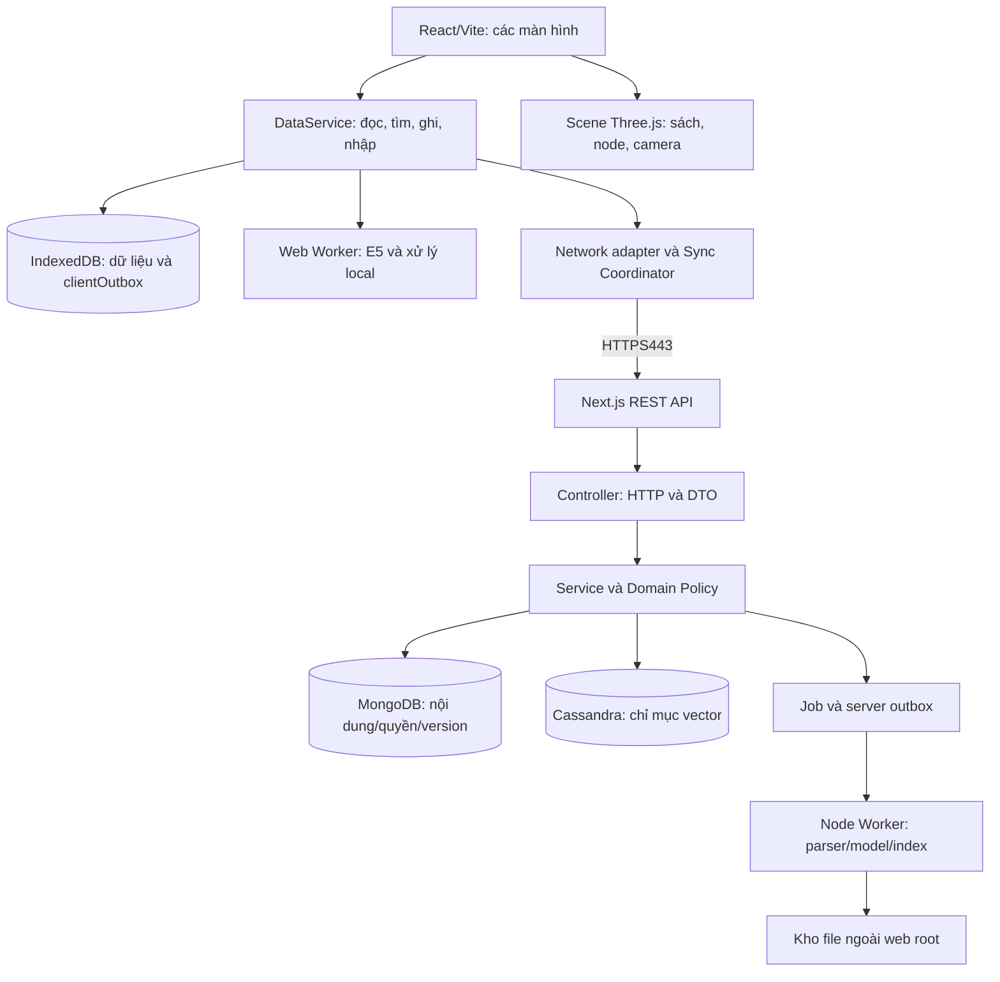

# Thiết kế phần mềm Paper Magic

Cập nhật 14/11/2026 cho FR17, FR20 và FR24. Các sơ đồ và API dưới đây mô tả thiết kế đích.

## 1. Sản phẩm được thiết kế

Paper Magic là thư viện nghiên cứu và học tập có tìm kiếm ngữ nghĩa. Người dùng tìm bài báo và tài liệu học trong cùng một ô tìm kiếm, đọc các đoạn liên quan trên giao diện sách Three.js, lưu/ghi chú và nhận câu trả lời có dẫn chứng.

Ba giá trị chính: tìm theo ý nghĩa thay vì chỉ nhớ từ khóa, xem kết nối giữa tài liệu, giữ khả năng tìm/đọc phần đã tải khi không có kết nối server.

| Vai trò | Quyền sử dụng |
|---|---|
| Khách | Tìm/đọc thư viện công khai và dữ liệu công khai đã tải |
| Người có tài khoản | Thêm tài liệu riêng, ghi chú, bộ sưu tập, lịch sử và đồng bộ |
| Quản trị | Nhập dataset đã kiểm, theo dõi job và yêu cầu lập lại chỉ mục |

Tài liệu riêng mặc định chỉ chủ sở hữu được đọc. Chia sẻ công khai và OCR là phần mở rộng, chưa nằm trong hợp đồng API lõi này. Thiết kế chức năng không đồng nghĩa tất cả đã triển khai.

## 2. Cấu trúc màn hình và điều hướng

```text
Khám phá /explore
  + Tìm kiếm và bộ lọc
  + Danh sách kết quả
  + Sách Three.js, node và kết nối
  + Chi tiết /documents/:id
  + Trả lời kèm dẫn chứng

Thư viện cá nhân /library
  + Tài liệu đã thêm /library/documents
  + Thêm tài liệu /library/import
  + Bài đã lưu /library/bookmarks
  + Bộ sưu tập /collections/:id
  + Ghi chú /notes
  + Lịch sử tìm /history

Tài khoản /account
  + Đăng ký /register và đăng nhập /login
  + Hồ sơ
  + Trạng thái đồng bộ/tải offline

Thiết lập giao diện (khách hoặc đăng nhập)
  + Theme, cỡ chữ, giảm chuyển động, chất lượng cảnh

Quản trị /admin
  + Nhập dataset
  + Trạng thái job /admin/jobs
```

URL frontend là điều hướng React, khác route API backend. Các path frontend là đề xuất cho router mới, chưa tồn tại đầy đủ trong App.tsx hiện tại.

| Màn hình | Người dùng thao tác gì | Kết quả và trạng thái cần hiển thị |
|---|---|---|
| Khám phá | Nhập câu hỏi, lọc nguồn/lĩnh vực/năm | Kết quả local trước, server bổ sung; loading/empty/error; provenance và scope |
| Chi tiết/đọc | Chọn hit, node hoặc citation | Tên, tác giả, coverage, đoạn/trang đúng nguồn; đọc abstract không giả toàn văn |
| Tiếp tục đọc | Mở lại vị trí đã lưu | Mở đúng phiên bản và mốc. Khi bản cũ hết khả dụng, hiển thị lựa chọn mở bản hiện hành từ đầu. |
| Nhập tài liệu | Chọn PDF có text/TXT/MD | Trạng thái queued/extracting/chunking/embedding/indexing/ready/failed |
| Thư viện | Lưu bài, tìm trong phần đã lưu, mở tài liệu | Tách public/private, thấy tài liệu chưa xử lý và phần sẵn sàng offline |
| Tài liệu đã nhập | Chủ sở hữu sửa metadata, thay file hoặc xóa | Hiển thị phiên bản đang phục vụ và tiến độ thay file. Sau khi xóa, dừng phục vụ mọi phiên bản. |
| Collection/Note | Tạo/sửa/xóa, thêm tài liệu hoặc ghi chú | Lưu cục bộ, pending/synced/conflict rõ; không xóa tài liệu khi xóa collection |
| History | Chọn câu hỏi cũ hoặc xóa mục | Tìm lại với dữ liệu hiện tại, không giả kết quả luôn giống lần trước |
| Tài khoản | Đăng nhập/đăng xuất và sửa hồ sơ | Có phiên, phiên hết hạn, hoặc hồ sơ offline; không tự xác thực lại khi mất mạng |
| Thiết lập | Chọn theme, cỡ chữ, giảm chuyển động và chất lượng cảnh | Khôi phục từ IndexedDB theo hồ sơ trình duyệt. Đổi tài khoản vẫn giữ cấu hình. |
| Quản trị | Chọn manifest dataset, theo dõi/reindex | Số lượng accepted/rejected, lỗi/job và version công bố |

## 3. Cấu trúc hệ thống



Frontend dùng React/Vite; backend Next.js modular monolith, worker Node riêng cho xử lý nặng. Không thêm Express hoặc microservice khi chưa có nhu cầu. Toàn bộ code ứng dụng, AI wrapper và test dùng JS/TS. Nginx là cấu hình hạ tầng HTTPS443, database không public ra Internet.

Three.js chỉ render hình khối/texture, raycast và camera. JS/TS tính tọa độ, số phức, sin/cos, dt và nội suy. Cảnh không gọi API/DB và không chạy embedding trong vòng render. DataService gửi view model có documentId, point, score, edges và trạng thái; trang sách thể hiện dữ liệu này. Dữ liệu nguồn không bị thay đổi khi node bay hoặc camera xoay.

## 4. Mô hình dữ liệu của phần mềm

| Tài nguyên | Trách nhiệm và quan hệ |
|---|---|
| Dataset | Gói dữ liệu công khai đã kiểm có manifest/version, chứa nhiều Document |
| Document | Một bài báo hoặc tài liệu học, có nhiều version và một activeVersion |
| DocumentVersion | Văn bản nguồn/coverage/provenance; chứa nhiều Chunk |
| Chunk | Đoạn có page/section/offset, là căn cứ dẫn chứng |
| Embedding | Vector cho Document hoặc Chunk, đúng model/pipeline/generation |
| Search | Lượt tìm có scope, filter, revision và thời hạn đọc lại |
| Answer | Kết quả sinh dựa trên evidence của Search, có mode và job |
| User/Session | Danh tính, phiên và vai trò; không coi client tự khai owner là quyền |
| Bookmark/Collection/Note | Dữ liệu cá nhân tham chiếu tài liệu, có revision |
| ReadingState | Mốc theo cặp tài khoản và tài liệu, trỏ tới phiên bản đã đọc, có revision |
| BrowserSettings | Thiết lập cục bộ theo hồ sơ trình duyệt |
| Job | Tiến độ xử lý nền và lỗi có thể kiểm tra |

Mongo lưu nội dung/quyền và dữ liệu cá nhân. Cassandra lưu chỉ mục có thể dựng lại, không quyết định quyền. IndexedDB lưu phần đã chọn dùng trên thiết bị và thay đổi chờ gửi. Raw/PDF ở kho file ngoài web root, API có quyền mới tải được. Summary là dữ liệu dẫn xuất để đọc nhanh, không thay văn bản gốc hoặc bằng chứng.

Chi tiết thu thập, phân loại và kiểm data: [26-data-domain-baseline.md](26-data-domain-baseline.md). Bộ Drive 7.500 bài đã qua kiểm kỹ thuật nhưng toàn bộ đang mang nhãn AI/năm 2026, chưa đủ bốn ngành hoặc chunk toàn văn. Chưa nhập thay corpus hiện tại.

## 5. Bốn luồng xử lý chính

### 5.1 Tìm và đọc

1. Người dùng submit câu hỏi. DataService tạo queryId và lịch sử một lần.
2. Local engine tìm trong dữ liệu trên thiết bị; nếu đủ tài nguyên thì trả kết quả ban đầu.
3. Khi backend truy cập được, gửi POST searches. Server kiểm quyền/filter, tạo query vector, tìm candidate Cassandra, lấy đoạn chuẩn và kiểm quyền/generation ở Mongo, ranking rồi trả hits.
4. Client chỉ áp dụng response đúng queryId đang xem; cache phần được phép, cập nhật danh sách/node.
5. Người dùng chọn tài liệu hoặc citation, client đọc bản local hoặc bổ sung chi tiết đúng version từ API.

Màu lấy từ cosine của câu hỏi gốc với evidence; rankScore phục vụ xếp hạng có thể khác cosine. Point3D dùng PCA có projectionRevision, không đo độ đúng bằng khoảng cách nhìn thấy. Cảnh chỉ dựng tập node/cạnh trong ngân sách, không dựng 7.500 mesh và tính mọi cặp trên client.

### 5.2 Thêm tài liệu học vào tìm kiếm

1. Chọn file, kiểm loại/quota. Nếu offline, file và metadata nằm local; chỉ localReady nếu parser/model đã xử lý xong.
2. Khi có phiên hợp lệ, POST documents cùng ID/key, server lưu file staging và tạo Document, trả 201 + Location + jobId, trạng thái queued.
3. Worker bóc text, chuẩn hóa, chia đoạn giữ trang/mục, tạo vector, ghi index generation mới.
4. Chỉ publish active generation khi nội dung và index khớp. Nếu lỗi, Document chưa ready, job có mã lỗi; retry không tạo tài liệu trùng.
5. Client đọc job/sync, nhận Document ready; cùng một search tìm được cả paper và study.

Thay file gửi `baseDocumentRevision` trong multipart lấy từ Document, rồi nhận 201 với version và jobId. Giữ phiên bản cũ đang phục vụ đến khi worker kích hoạt thành công yêu cầu thay mới nhất. Mốc đọc và citation của phiên bản cũ vẫn trỏ vào bản cũ. Xóa đánh dấu tombstone để chặn đọc và công bố mọi phiên bản trước khi dọn file và index. [Hợp đồng FR20](27-backend-domain-baseline.md#fr20-thay-file-và-theo-dõi-xử-lý)

### 5.3 Trả lời có dẫn chứng

1. Search có kết quả trước; người dùng chọn trả lời bằng dẫn chứng.
2. POST answers gửi searchId; server kiểm lại quyền/current evidence, tạo job 202 + Location.
3. Worker dùng đoạn nguồn để sinh câu trả lời, kiểm format/citation; không đủ bằng chứng trả insufficient, model lỗi giữ extractive.
4. Client poll job với backoff và GET answer. Citation mở đúng tài liệu/version/đoạn.

Không đưa vector vào LLM thay văn bản, không coi summary AI là bằng chứng gốc. Offline không kết nối được backend chưa có Qwen đầy đủ; vẫn tìm/đọc phần local.

### 5.4 Ghi và đồng bộ

1. Bookmark, note, collection, history, vị trí đọc đi qua DataService, transaction IDB ghi draft + clientOutbox.
2. Online gửi ngay, offline chờ. Cùng adapter tạo cùng REST method/path/body/key cho cả hai trường hợp.
3. Controller → service/policy → Mongo transaction(entity + receipt + changeLog + serverOutbox khi cần).
4. Client nhận canonical response mới xác nhận operation, pull feed để nhận thay đổi từ thiết bị khác.
5. Conflict giữ bản nháp và canonical, không ghi đè âm thầm. Cursor update cùng transaction dữ liệu; session hết hạn thì dừng sync riêng.

FR17 tạo mốc qua PUT trả 201 và Location, cập nhật trả 200. Cả hai trả revision trong body. Client lấy ETag qua GET mốc trước lần PUT cập nhật. Khi đọc lại, lấy nội dung qua `versionId` của mốc. FR24 dùng IndexedDB trực tiếp theo hồ sơ trình duyệt, với API server và hàng đợi đồng bộ nằm ngoài luồng thiết lập. [Hợp đồng FR17](27-backend-domain-baseline.md#fr17-đọc-và-ghi-mốc-theo-revision)

Không có thêm /sync/push thực thi cùng nghiệp vụ theo luật thứ hai. Auth không xếp password/token vào outbox. Server mất liên lạc sau commit được xử lý bằng receipt idempotency, không tạo bản ghi lần nữa.

## 6. Thiết kế API như hợp đồng

Contract mới dùng `/api/v4` nhất quán vì v1–v3 đã tồn tại trong source. Version không gắn với từng module hay hybrid search. Triển khai mới phải có test/staging rồi chuyển client có kiểm soát. Bộ OpenAPI đầy đủ theo registry mới nằm ở [software-api.openapi.json](design/software-api.openapi.json), thay OpenAPI 45 endpoint đề xuất ngày 12/11.

### Ví dụ tạo bộ sưu tập

```http
POST /api/v4/collections
Content-Type: application/json
Idempotency-Key: 1f4f7dbf-2c91-4512-8945-ccacbf15b4bc
X-CSRF-Token: <token-tu-phien>

{"id":"3fb04de2-07c1-4846-80f6-28ae11616b5a","name":"AI y tế"}
```

```http
HTTP/1.1 201 Created
Location: /api/v4/collections/3fb04de2-07c1-4846-80f6-28ae11616b5a
ETag: "1"

{"id":"3fb04de2-07c1-4846-80f6-28ae11616b5a","name":"AI y tế","revision":1,"updatedAt":"2026-11-13T03:00:00Z"}
```

Replay cùng key/body trả kết quả đã commit sau kiểm quyền hiện tại; key cũ với payload khác trả 409. PATCH sửa tên dùng If-Match: "1"; revision cũ trả 412, không ghi đè tên mới hơn.

### Ví dụ tìm kiếm

```http
POST /api/v4/searches
Content-Type: application/json
Idempotency-Key: 1a4e4c4a-990c-4c89-9682-87bd97840c56

{"queryId":"1a4e4c4a-990c-4c89-9682-87bd97840c56","query":"Phương pháp giảm quá khớp khi học sâu","topK":12,"filters":{"kinds":["paper","study"]}}
```

Kết quả 201 có Location Search, hits gồm DocumentSummary, quote có Chunk/version/page, cosine/rankScore/point, model/pipeline/projection revision. Không gửi lại toàn corpus. SearchRun có TTL; GET sau hết hạn trả 410 và client tìm lại. SearchHistory là dữ liệu riêng khác tài nguyên SearchRun.

## 7. Đối chiếu tám mục trong ảnh tham khảo

| Mục | Quyết định cụ thể |
|---|---|
| Domain model | Document có versions/chunks, Collection có items; API theo quan hệ thật |
| HTTP methods | GET đọc; POST tạo; PUT đặt membership/bookmark; PATCH sửa một phần; DELETE gỡ/xóa |
| Idempotency | POST tạo nhận key; mutation offline giữ operation key/revision; kiểm receipt trước precondition của replay đã commit |
| Status | 201+Location resource; 202+Location job; 204 logical delete; 401/403/404/409/412/422/429/503 phân biệt |
| Versioning | Một contract đích v4, chuyển đổi qua staging; không tăng version chỉ vì thêm endpoint tương thích |
| Semantic paths | Danh từ số nhiều: documents, collections, notes, searches, answers; sessions là tài nguyên xác thực |
| Batch | POST datasets là batch import có job và báo cáo từng bản ghi; GET documents nhận ids tối đa 100, không gửi cả corpus |
| Query language | Filter/sort/cursor có field whitelist, giới hạn và quy tắc rõ; không nhận raw Mongo/CQL filter |

PATCH là phương thức hợp lệ cho partial update. PUT không mặc định là sửa một phần. Idempotent nói về tác dụng cuối cùng, không yêu cầu mọi lần gọi có status giống nhau. Phân trang và cơ chế xác thực là các phần contract/security cần thiết nhưng không thay tư duy tài nguyên/nghiệp vụ.

Ví dụ: `GET /api/v4/documents?kind=paper&subject=medicine&yearFrom=2020&sort=updatedAt:desc&limit=20&cursor=...`. Sort whitelist và cursor gắn filter/scope; không dùng cú pháp tùy ý để client điều khiển query DB.

## 8. Ràng buộc triển khai và nghiệm thu

Lõi phải có dữ liệu nguồn đáng tin, ingestion đúng version, tìm có quyền, evidence và Three.js hiển thị đúng kết quả. Tài khoản và tiện ích dùng chung nền tảng identity/sync. Cấu trúc Controller/Service/Domain/Repository chi tiết trong [27](27-backend-domain-baseline.md), không yêu cầu tách service thành hàng chục tiến trình.

Kiểm dữ liệu → unit/domain → contract DTO/HTTP → DB/model/file integration → E2E và offline/retry → performance/security → staging → production. Lưu bằng chứng đúng commit/dataset/model, không lấy số test cũ làm kết quả chức năng mới.

Mỗi module triển khai có README, nhật ký phát triển và kiểm chứng. FR17 và FR20 ở trạng thái hợp đồng thiết kế. Xem [ca nghiệm thu](28-design-decisions-and-verification.md#ca-nghiệm-thu-fr17-fr20-và-fr24) trước khi triển khai.
